# Projeto - Cidades ESG Inteligentes | Órbita Alerta

API ESG em C# / .NET 8 para registro de alertas ambientais de cidades inteligentes, com ciclo DevOps completo: build e testes automatizados, imagem Docker, orquestração com Docker Compose e deploy automatizado em **staging** e **produção** no Azure.

| Ambiente | URL |
|---|---|
| Staging | https://orbita-alerta-staging-mg.azurewebsites.net/health |
| Produção | https://orbita-alerta-production-mg.azurewebsites.net/health |

Endpoints: `GET /health`, `GET /api/alerts` e `POST /api/alerts`.

## Como executar localmente com Docker

Pré-requisito: Docker Desktop com Compose V2.

```powershell
Copy-Item .env.example .env        # no Linux/macOS: cp .env.example .env
docker compose up --build -d
docker compose ps
Invoke-RestMethod http://localhost:8080/health
```

Resposta esperada: `{"status":"healthy","service":"orbita-alerta-api","environment":"Development"}`.

Criar e listar alertas:

```powershell
$body = @{ title='Alerta de qualidade do ar'; category='air-quality'; severity='medium'; city='Curitiba'; description='Partículas acima do limite.' } | ConvertTo-Json
Invoke-RestMethod -Method Post -Uri http://localhost:8080/api/alerts -ContentType 'application/json' -Body $body
Invoke-RestMethod http://localhost:8080/api/alerts
```

Logs e encerramento:

```powershell
docker compose logs -f api
docker compose down        # preserva o volume do MongoDB; use -v para apagá-lo
```

Testes sem Docker: `dotnet test tests/OrbitaAlerta.Api.Tests/OrbitaAlerta.Api.Tests.csproj`.

## Pipeline CI/CD

Ferramenta: **GitHub Actions**, em [.github/workflows/ci-cd.yml](.github/workflows/ci-cd.yml). Os jobs são encadeados por `needs`, então nada é publicado se o build ou os testes falharem.

| Job | Quando | O que faz |
|---|---|---|
| Build e testes | PR e push em `develop`, `qa`, `main` | Setup .NET 8, restore, build Release, testes xUnit com cobertura e upload dos resultados |
| Build e publicação da imagem | push em `qa` ou `main` | Build multi-stage e push no GHCR com as tags `<sha>` e `<branch>-latest` |
| Deploy staging | push em `qa` | `azure/webapps-deploy` no Web App de staging + smoke test em `/health` e `/api/alerts` |
| Deploy production | push em `main` | Mesmo processo no Web App de produção (GitHub Environment `production`) |

```text
develop -> build + testes
qa      -> build + testes -> imagem GHCR -> deploy staging    -> smoke test
main    -> build + testes -> imagem GHCR -> deploy production -> smoke test
```

### Infraestrutura no Azure (capacidade mínima)

| Recurso | Configuração |
|---|---|
| App Service Plan `plan-orbita-alerta` | Linux F1 (gratuito) |
| Web Apps `orbita-alerta-staging-mg` e `orbita-alerta-production-mg` | Container da imagem do GHCR, porta 8080 |
| Cosmos DB `orbita-alerta-cosmos-mg` | API MongoDB, free tier, bancos `orbita_alerta_staging` e `orbita_alerta_production` |

O provisionamento está em [scripts/azure-provision.sh](scripts/azure-provision.sh).

### Secrets do repositório

| Secret | Finalidade |
|---|---|
| `AZURE_WEBAPP_STAGING` | Nome do Web App de staging |
| `AZURE_WEBAPP_STAGING_PUBLISH_PROFILE` | Publish profile do staging |
| `AZURE_WEBAPP_PRODUCTION` | Nome do Web App de produção |
| `AZURE_WEBAPP_PRODUCTION_PUBLISH_PROFILE` | Publish profile da produção |

A string de conexão do banco (`MONGO_CONNECTION_STRING`, `MONGO_DATABASE`) fica apenas nas configurações de cada Web App.

## Containerização

Conteúdo do [Dockerfile](Dockerfile):

```dockerfile
# syntax=docker/dockerfile:1

FROM mcr.microsoft.com/dotnet/sdk:8.0 AS build
WORKDIR /src
COPY ["src/OrbitaAlerta.Api/OrbitaAlerta.Api.csproj", "src/OrbitaAlerta.Api/"]
RUN dotnet restore "src/OrbitaAlerta.Api/OrbitaAlerta.Api.csproj"
COPY . .
RUN dotnet publish "src/OrbitaAlerta.Api/OrbitaAlerta.Api.csproj" \
    --configuration Release \
    --output /app/publish \
    --no-restore \
    /p:UseAppHost=false

FROM mcr.microsoft.com/dotnet/aspnet:8.0 AS runtime
WORKDIR /app
EXPOSE 8080
ENV ASPNETCORE_URLS=http://+:8080
ENV DOTNET_SYSTEM_GLOBALIZATION_INVARIANT=false
COPY --from=build /app/publish .
USER app
ENTRYPOINT ["dotnet", "OrbitaAlerta.Api.dll"]
```

Estratégias adotadas:

- **Multi-stage:** o SDK só existe na etapa de build; a imagem final tem apenas o runtime ASP.NET Core e os binários publicados.
- **Cache de camadas:** o `.csproj` é copiado e restaurado antes do restante do código, então o restore só roda de novo quando as dependências mudam.
- **Segurança:** execução com o usuário não privilegiado `app`; `.env`, `bin/`, `obj/` e `.git` ficam fora da imagem (`.dockerignore`).
- **Compose:** serviços `api` e `mongodb`, rede `orbita-alerta-network`, volumes `orbita-alerta-mongodb-data` e `orbita-alerta-mongodb-config`, variáveis via `.env` (modelo em `.env.example`) e `depends_on` com healthcheck do MongoDB.

## Prints do funcionamento

Prints de terminal: capturas reais de janelas do Windows PowerShell, geradas por [scripts/collect-evidence.ps1](scripts/collect-evidence.ps1). As saídas em texto estão em [docs/evidencias/terminal](docs/evidencias/terminal).

### Build e testes

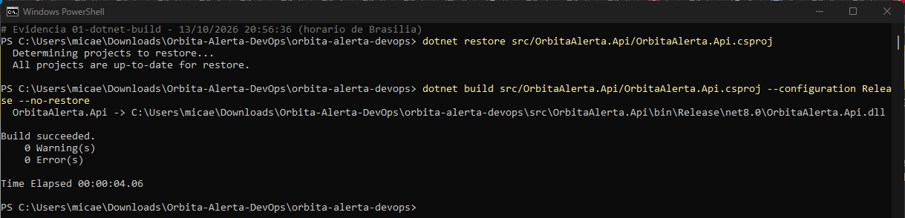
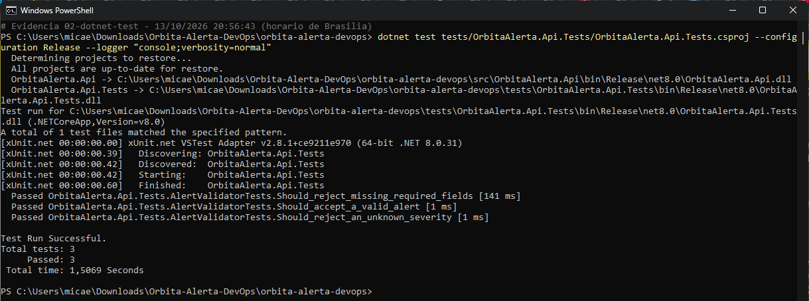

### Pipeline no GitHub Actions

Run #4 (branch `qa`): deploy em **staging** concluído.

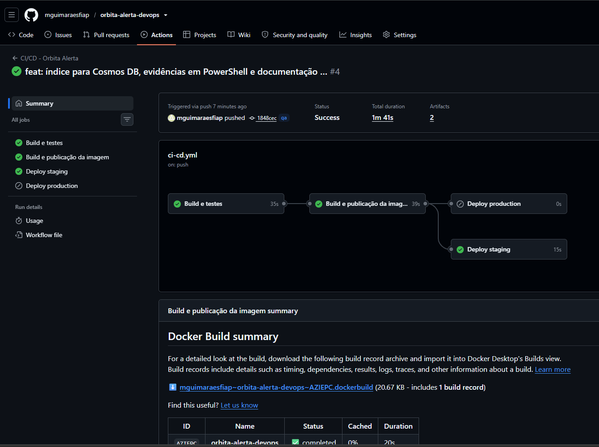

Run #5 (branch `main`): deploy em **produção** concluído.

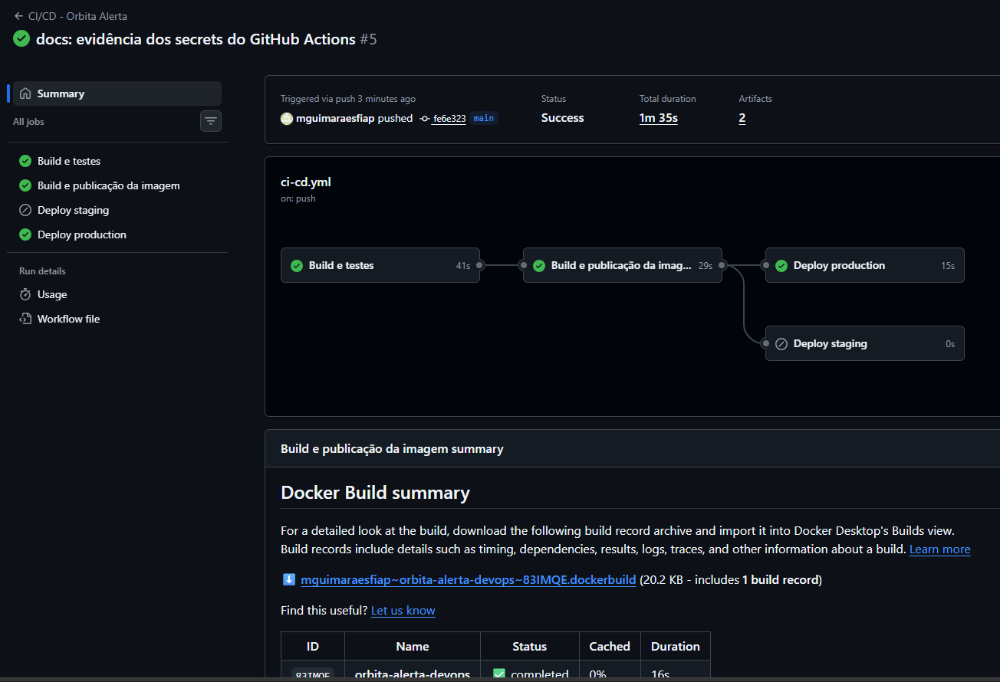

Secrets do Azure cadastrados no repositório:

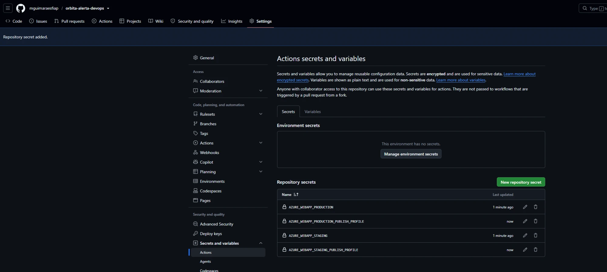

### Docker Compose

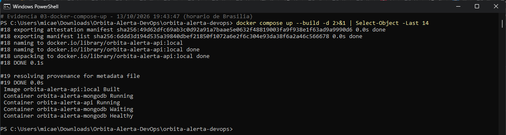
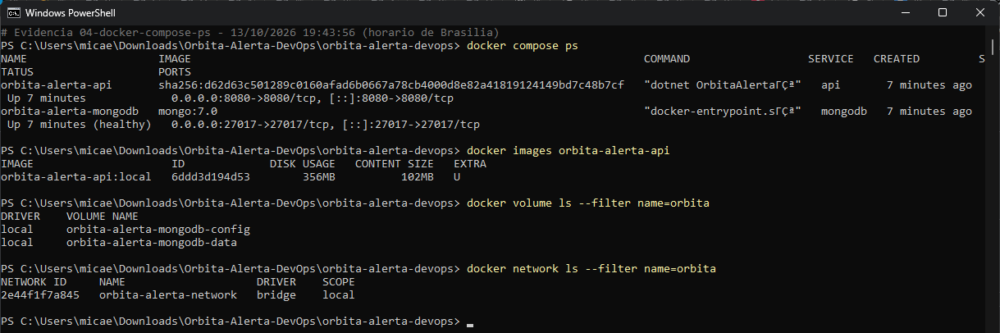
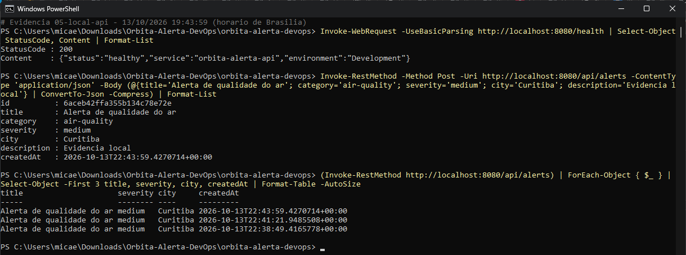

### Azure: staging e produção

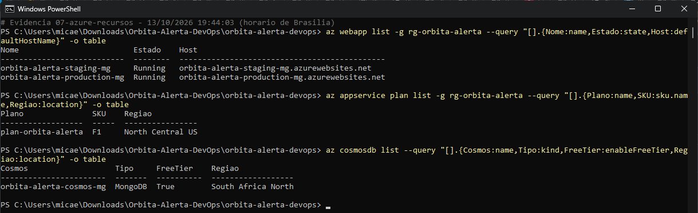
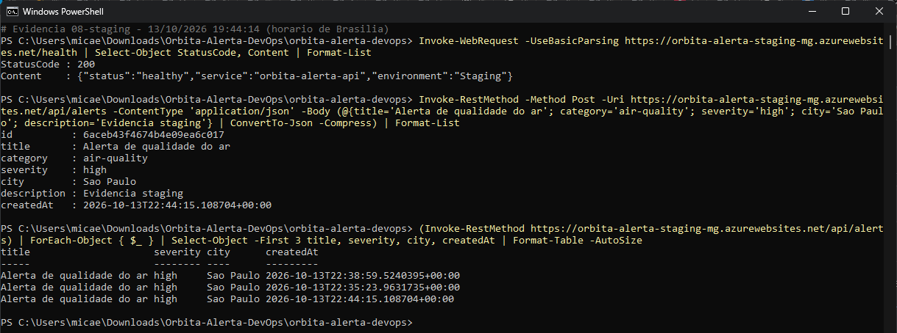
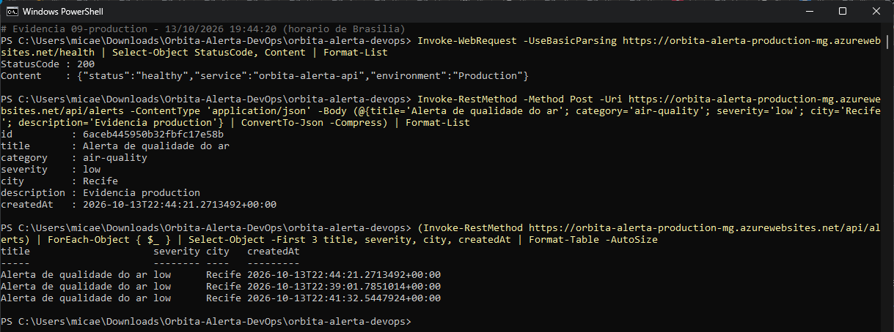

Para regenerar os prints e o PDF:

```powershell
powershell -ExecutionPolicy Bypass -File scripts/collect-evidence.ps1
python docs/generate_documentation.py
```

## Tecnologias utilizadas

- C# / .NET 8 / ASP.NET Core Minimal API
- MongoDB 7 (local) e Azure Cosmos DB com API MongoDB (nuvem), via MongoDB.Driver
- xUnit e coverlet
- Docker (multi-stage) e Docker Compose
- GitHub Actions e GitHub Container Registry (GHCR)
- Azure App Service for Containers (Linux) e Azure CLI
- PowerShell e Python/ReportLab (evidências e documentação)

## Estrutura do projeto

```text
orbita-alerta-devops/
├── .github/workflows/ci-cd.yml
├── Dockerfile
├── docker-compose.yml
├── .env.example
├── README.md
├── src/OrbitaAlerta.Api/
├── tests/OrbitaAlerta.Api.Tests/
├── scripts/            # provisionamento Azure, coleta de evidências, healthcheck
└── docs/
    ├── Orbita-Alerta-DevOps-Documentacao.pdf
    ├── arquitetura.md
    └── evidencias/     # prints (PNG) e saídas de terminal
```

## Checklist de entrega

| Item | OK |
|---|:---:|
| Projeto compactado em .ZIP com estrutura organizada | ☑ |
| Dockerfile funcional | ☑ |
| docker-compose.yml ou arquivos Kubernetes | ☑ |
| Pipeline com etapas de build, teste e deploy | ☑ |
| README.md com instruções e prints | ☑ |
| Documentação técnica com evidências (PDF ou PPT) | ☑ |
| Deploy realizado nos ambientes staging e produção | ☑ |

## Autoria

**Micaela Guimarães — FIAP**
